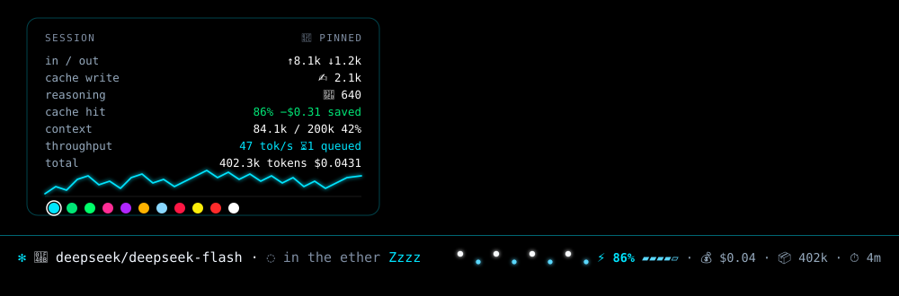
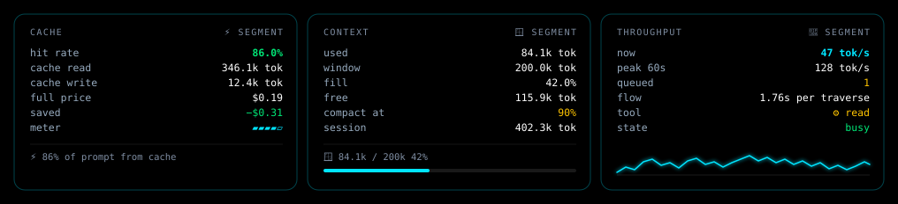
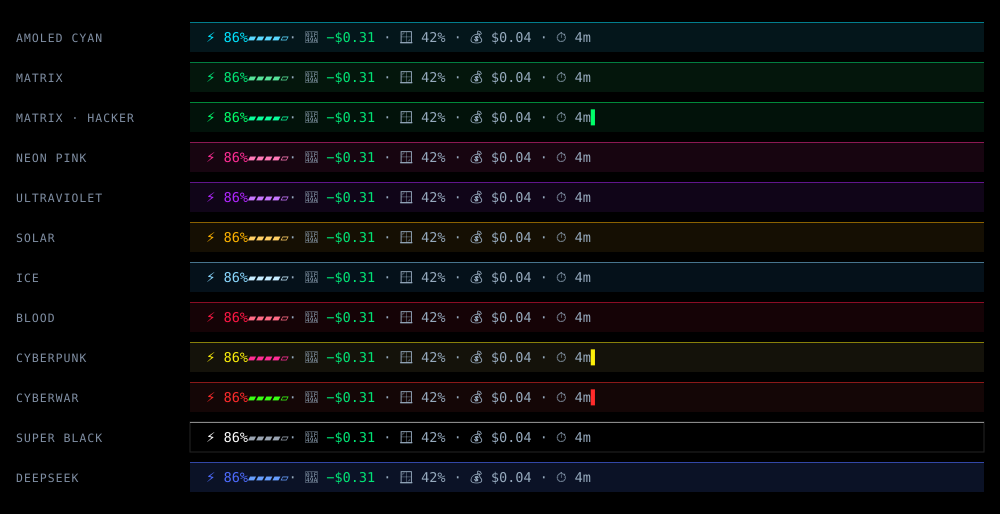

# OpenCode Desktop — Status Bar

<p>
  <a href="LICENSE"></a>
  
  
  
  
</p>

**A single-line telemetry HUD for the bottom of the [OpenCode](https://opencode.ai) desktop app.**



<sub>Preview above: the pinned hover card with the theme palette, and the bar itself. Vector
recreation of the real layout — true black, 12px type, accent `#00e5ff`.</sub>

Model, live status phrases, a token-flow lane that streams at your current tok/s, cache hit rate,
context fill, cost, cache savings, queue depth and a session timer — all driven by the server's
event stream, with no polling in the hot path.

---

## Features

- **Live state, not guesses.** Working/idle comes from the authoritative `session.status` stream,
  so the bar stays awake through steering messages, queued prompts and retries.
- **Token flow lane.** Data bits drift left → right at a speed derived from rolling tok/s
  (128px lane, 8 bits, two-tone). Idle trickles at one traverse per two breaths.
- **Factory mode.** While a tool call runs, bits pinch down through a spinning `⚙` in the middle
  of the lane and bloom back out.
- **Breathing.** The whole strip breathes at a human rate — 12 bpm idle, 16 bpm working, with an
  asymmetric inhale/hold/exhale curve.
- **Splash.** Click the model name: two crests converge from the ends of the bar, collide where you
  clicked, flash, then bounce back out. A turn starting fires the same wave.
- **Telemetry card.** Hover the `⚙️ build` / `plan` chip and it opens at the bar's bottom-left corner —
  no cursor chasing, no popping up when you move around.
- **Pin it.** Double-click an open card to freeze it while you click swatches or toggles.
- **12 themes**, including full "skins" that swap spinner glyphs, phrase pools, scanlines and a
  terminal cursor — plus a **deepseek** palette lifted from deepseek.com's design tokens.
- **Whale mode.** Running a `deepseek` model floods the bar with its own tint.

## Screenshots

### The card

One panel, opened from the agent chip, anchored bottom-left. Rows for cache, context (with fill bar),
throughput (with the 60s sparkline and live tool state), cost and the session.



### Every theme

Twelve palettes — three of which are full **skins** that also swap spinner glyphs, phrase pools,
scanlines and the cursor.



---

## Install

Two steps. No build required — the compiled bundle is committed in `dist/`.

### 1. Clone into the plugins folder

**macOS / Linux**

```bash
git clone https://github.com/devopshelper/opencode-desktop-statusbar.git \
  ~/.config/opencode/plugins/desktop-statusbar
```

**Windows (PowerShell)**

```powershell
git clone https://github.com/devopshelper/opencode-desktop-statusbar.git `
  "$env:USERPROFILE\.config\opencode\plugins\desktop-statusbar"
```

### 2. Register it

Add the directory to the `plugins` array in `~/.config/opencode/opencode.json`:

```json
{
  "plugins": [
    "C:/Users/you/.config/opencode/plugins/desktop-statusbar"
  ]
}
```

Restart the desktop app once. After that the server watches `dist/` and hot-reloads the bar in every
window whenever the bundle changes.

### Verify

The bar appears at the bottom of the window. Logs land in
`~/.local/share/opencode/log/opencode.log` — look for `loading plugin` with
`entrypoint=.../dist/gui-experimental.cjs`, and no `failed to load`.

---

## Updating

```bash
cd ~/.config/opencode/plugins/desktop-statusbar && git pull
```

The app picks up the new bundle on its own.

---

## Usage

| Action | Result |
|---|---|
| **Hover `⚙️ build` / `plan`** | Open the telemetry card at the bar's bottom-left corner |
| **Hover the card** | Keeps it open while you click controls |
| **Click 🤖 model name** | Splash — two crests collide where you clicked |
| **Double-click an open card** | Pin / unpin it (a dbl-click on a closed bar does nothing) |
| **Click a swatch** | Recolor the entire bar instantly (remembered) |
| **Click `FX`** | Toggle lite mode — drop full-surface motion, including the splash |
| **`−` / `+`** | Bar height, 2–18px of vertical padding |

Segment panels: `🤖` model/pricing · `⚡` cache · `🪟` context · `📦` tokens · `💰` cost · `🌊` throughput.

### Height

The bar's height *is* its vertical padding, so the control just steps it from **2px to 18px** in 2px
increments — compact enough for a 19" rack console, tall enough to sit comfortably on a big display.
Nothing else scales, so the fixed-width status slot and 128px flow lane stay exactly as tuned.
Persisted in `localStorage["desktop.statusbar.pad"]`.

### Lite mode (Windows Server / RDP / no GPU)

Pin the card and hit **`FX`**. It removes the **full-surface repaints** — the expensive part on
software rendering — while leaving all the cheap, small motion in place:

| Removed | Kept |
|---|---|
| bar breathing (`inset box-shadow` across the whole strip, 60fps) | particle lane at its normal speed |
| event ping (full-width flash on every server event) | status phrase rotation |
| splash waves (two crests converging on the bar, on click and turn start) | Zzzz drift, animated dots, factory gear |
| hover `brightness` filter | token bump, cost flash |
| sparkline `drop-shadow` filter | timer, percentages, block meter |
| ambient glow shadow | static glow halo on the status phrase |

The glyph morph stays too, just slowed from **130ms → 300ms** — it's a text swap inside a fixed box,
so it costs almost nothing in either mode.

Lite mode defaults to **on** when the OS reports `prefers-reduced-motion: reduce`, and the explicit
choice is remembered in `localStorage["desktop.statusbar.lite"]`.

---

## Themes

| Swatch | Theme | Accent | Skin |
|---|---|---|---|
| 🔵 | amoled cyan | `#00e5ff` | — |
| 🟢 | matrix | `#00e676` | — |
| 🟩 | matrix · hacker | `#00ff6a` | katakana glyphs, scanlines, cursor |
| 🩷 | neon pink | `#ff2d95` | — |
| 🟣 | ultraviolet | `#b026ff` | — |
| 🟡 | solar | `#ffb300` | — |
| 🧊 | ice | `#8ad8ff` | — |
| 🔴 | blood | `#ff1744` | — |
| 🟨 | cyberpunk | `#fcee0a` | `◈◇◆◉◊`, scanlines, cursor |
| 🟥 | cyberwar | `#ff2b2b` | `◤◥◣◢▮`, scanlines, cursor |
| ⬛ | super black | `#ffffff` | — |
| 🔵 | **deepseek** | `#4d6bfe` | brand palette from deepseek.com |

Selection persists in `localStorage["desktop.statusbar.theme"]`.

---

## Build from source

```bash
npm install
npx vite build      # -> dist/gui-experimental.cjs
```

Requirements: Node 18+, `vite` 7, `solid-js` 1.9. The build must stay **CommonJS** — the host loads
the bundle with `require()`.

---

## How it works

- **Event driven.** `session.status` (idle/busy/retry), `session.inbox.*` (queued/steering),
  `session.tool.*` (factory mode), usage/step events, VCS changes. A 15s poll is only a safety net.
- **No layout animation.** Everything is `transform` / `opacity` / `box-shadow` / `text-shadow`.
- **Stable DOM.** Animated elements are created once and updated reactively; nothing is rebuilt on a
  timer.
- **Themed by variables.** Four CSS custom properties (`--sb-glow`, `--sb-accent`, `--sb-accent2`,
  `--sb-wash`) drive every glow, particle, hairline and tint.

Text is never reflowed by phrase changes: the status slot is a fixed-width box, and the spinner glyph
lives in a fixed-width box (its glyph set has varying advance widths).

### Rebuilding the look elsewhere

The visual system is documented independently of the Solid component, so it can be ported to another
host (web app, Electron panel, TUI):

| File | What it is |
|---|---|
| [`docs/STYLE.md`](docs/STYLE.md) | the full spec: tokens, anatomy, states, motion timings, splash geometry, lite-mode contract, porting checklist, and the traps we already hit |
| [`docs/statusbar.css`](docs/statusbar.css) | the same design as a framework-agnostic, attribute-driven stylesheet — no build step |
| [`docs/themes.json`](docs/themes.json) | palettes, rhythm, semantic colors and derived formulas in machine-readable form |
| [`docs/demo.html`](docs/demo.html) | live playground to check a port: theme picker, state toggles, FX off, click-to-splash |

---

## Privacy

The plugin only reads data from the local OpenCode client. No network calls, no telemetry, no
external services. The theme preference is stored locally.
